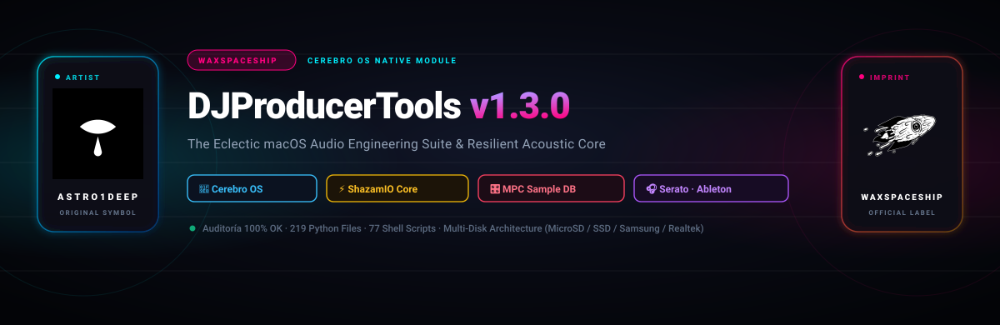

<div align="center">
  
</div>

# 🎧 DJProducerTools v1.3.0

Professional DJ & Music Production Suite for macOS | [Versión en Español](README_ES.md)

[](https://www.gnu.org/software/bash/)
[](https://www.apple.com/macos/)
[](LICENSE)

---

## Overview

**DJProducerTools** is an advanced, deterministic automation suite built to organize, audit, clean, and enrich music libraries for DJs and producers on macOS. Compatible with **Serato DJ Pro, Ableton Live, Traktor, Rekordbox, and Akai MPC ecosystems**, it provides bit-level deduplication (SHA-256), quarantine workflows, smart ID3 tag cleaning, real-time audio corruption checks, and local acoustic identification.

It includes dual-language native interactive launchers:
- 🇪🇸 `DJProducerTools_MultiScript_ES.sh` (Spanish)
- 🇺🇸 `DJProducerTools_MultiScript_EN.sh` (English)

---

## Key Features

| Feature | Status | Details |
|---|---|---|
| 📂 Catalog & Hash | ✅ Ready | Bit-by-bit SHA-256 index, exact duplicate plans, reversible quarantine |
| 🛡️ Safety & Quarantine | ✅ Ready | `SAFE_MODE=1` & `DJ_SAFE_LOCK=1` active by default, `DRYRUN_FORCE` preview |
| 💾 DJ Backups | ✅ Ready | rsync backups of `_Serato_` and DJ metadata (Serato/Traktor/Rekordbox/Ableton) |
| 🔍 TSV Reports | ✅ Ready | Hash snapshots, ffprobe corruption detection, DAW relink helpers, smart rescan |
| 🎧 ShazamIO Acoustic | ✅ Ready | Resilient 5-layer acoustic engine with SQLite cache, FFmpeg sanitizer, and offline fallback |
| 🎥 Video / OSC / DMX | ✅ Ready | FFprobe media inventory, H.264 transcode plans, playlist→OSC/DMX streaming |
| 🔌 Local API / OSC | ✅ Ready | Local HTTP server (`/status`, `/reports`) and OSC (`/djpt/ping`) with Bearer token |
| 🔊 BPM & Onsets | ✅ Ready | Lightweight BPM, key, and onset detection with `librosa` (read-only, preserves tags) |
| 🤖 Local ML & Deep | ✅ Ready | TensorFlow Hub, ONNX (CLAP/CLIP), and TFLite local embeddings with full offline mode |

---

## 🎧 Resilient Acoustic Identification Engine (ShazamIO)

Option `9` under the **Integrations Menu** activates the autonomous acoustic identification engine:

### Multi-System Target Support:
1. **Akai MPC Sample** (`/Volumes/MPCSMPL`): Identify vinyl chops and untagged sample packs for standalone MPCs.
2. **Serato DJ Pro** (`/Volumes/SanDisk SSD/00_SERATO_MUSICA`): Resolve live sets, "Track 01" files, and tracks missing ID3 metadata.
3. **Ableton Live & Production** (`/Volumes/samsung PSSDT7`): Track stems, sample clearance, and sound libraries.

### 5-Layer Defensive Architecture:
1. **Heuristic Guard**: Skips transient one-shots (<150 KB or <3.2s) to preserve network requests.
2. **Fast SQLite Cache**: Persisted in `~/.DJProducerTools/shazam_cache.db` with chunk hashing (0.001 ms response on cache hit).
3. **Async Concurrency & Timeout**: `asyncio.Semaphore(3)` with strict 8.0s timeout per file to prevent hanging sockets.
4. **FFmpeg Stream Sanitizer**: Transcodes damaged audio containers on-the-fly to clean PCM 16-bit 44.1 kHz.
5. **Autonomous Offline Heuristic Fallback**: Deduces artist, clean title, and mix version from folder and file structure when offline, guaranteeing zero unhandled crashes.

---

## Quick Installation

```bash
git clone https://github.com/Astro1Deep/DjProducerTool.git
cd DjProducerTool
chmod +x scripts/*.sh

# Run in Spanish
./scripts/DJProducerTools_MultiScript_ES.sh

# Run in English
./scripts/DJProducerTools_MultiScript_EN.sh
```

Or run directly via curl:
```bash
curl -fsSL https://raw.githubusercontent.com/Astro1Deep/DjProducerTool/main/install_djpt.sh -o install_djpt.sh
chmod +x install_djpt.sh
./install_djpt.sh
```

---

## System Requirements

- **OS**: macOS 10.15+ (Apple Silicon M1/M2/M3/M4 or Intel)
- **Shell**: Bash 4.0+ or Zsh
- **Core Tools**: `ffmpeg`, `ffprobe`, `sox`, `sqlite3`, `uv`, `python3` (3.9+)
- **Install CLI tools via Homebrew**:
  ```bash
  brew install ffmpeg sox sqlite3 uv
  ```

---

## Documentation & Wiki

- **Official GitHub Wiki**: [https://github.com/Astro1Deep/DjProducerTool/wiki](https://github.com/Astro1Deep/DjProducerTool/wiki)
- **Extended Technical Manual (ES)**: [`docs/wiki/WIKI_EXTENDED_MANUAL_ES.md`](docs/wiki/WIKI_EXTENDED_MANUAL_ES.md)
- **Extended Technical Manual (EN)**: [`docs/wiki/WIKI_EXTENDED_MANUAL_EN.md`](docs/wiki/WIKI_EXTENDED_MANUAL_EN.md)
- **Quick Guides**: [`guides/GUIDE_en.md`](guides/GUIDE_en.md) · [`guides/GUIDE_es.md`](guides/GUIDE_es.md)

---

## License

MIT License. See [LICENSE](LICENSE) for details.
